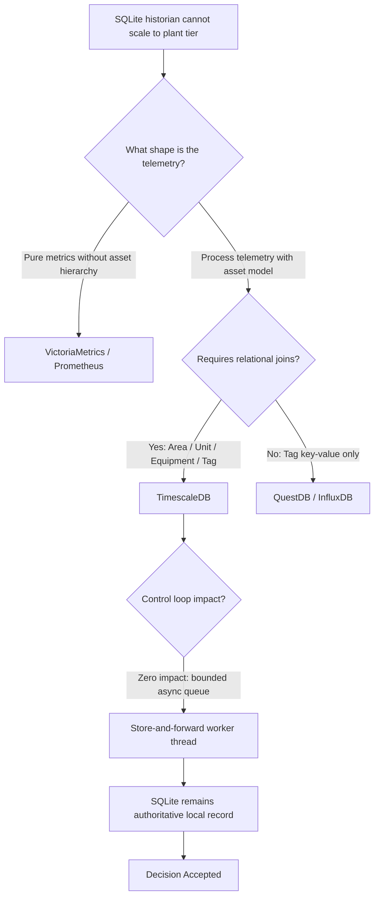
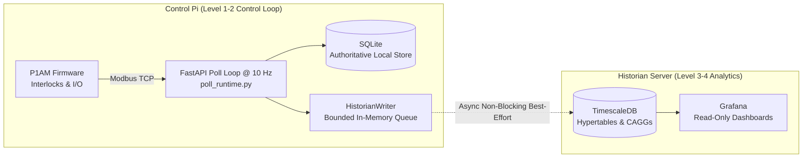

# ADR-0050: Plant Historian — TimescaleDB and Grafana for Telemetry and Analytics

- Status: Accepted
- Date: 2026-10-12
- Decision Makers: repo owner (Fleet Readiness Program #4046, #4951, D-sorganization/Repository_Management#1505)
- Related Issues/PRs: Tools#4046 (Historian epic H1-H9), Tools#4951 (Licensing ruling), Tools#5548 (H9 documentation/ADR), Tools#4065, ADR-0049, `docs/development/HISTORIAN_LICENSING_RULING.md`, `docs/scada/f_matrix.md`, `docs/scada/recovery_ledger.v1.json`, `docs/scada/historian_runbook.md`

## Context

The current P1AM SCADA telemetry store (`src/p1am_control_system/backend/historian.py` and `src/p1am_control_system/backend/database.py`) persists scan samples and event transitions into a local SQLite database (`dcs_scada.db`). While adequate for single-bench development (32 tags at 5 s capture intervals), SQLite on the control Raspberry Pi exhibits fundamental scaling limitations for production pilot plants:

1. **No compression:** Raw IEEE 754 floating-point samples are stored uncompressed; dedicated time-series engines achieve 10–20× columnar compression.
2. **Destructive retention:** Long-term retention in `src/p1am_control_system/backend/data_capture.py` relies on a byte-cap sweep (`P1AM_HISTORIAN_MAX_BYTES`) that deletes oldest rows. It lacks automated downsampling, destroying historical trend fidelity rather than aggregating it.
3. **Tag cardinality:** A production facility generates 5,000–50,000 tags. At 1 Hz that represents ~10,000 samples/s, which SQLite on SD/eMMC media cannot sustain concurrently with the 10 Hz control scan loop (`P1AM_POLL_INTERVAL_S`).
4. **Maintenance overhead:** In-house analytics in `data_explorer_*.py` reimplement query, aggregation, and plotting features provided off-the-shelf by industry-standard telemetry platforms.
5. **Single point of failure:** The telemetry store shares physical storage and I/O bandwidth with the controller node.

**Safety Invariant (Mandatory):** The historian must NEVER block, delay, or fail the 10 Hz PLC poll loop or any de-energizing/E-stop safety command. The control path takes absolute priority over telemetry persistence.

## Decision Flow

## Decision

Establish a dedicated **Level 3/4 information and telemetry layer** decoupled from the Level 1/2 control loop:

1. **TimescaleDB** as the long-term plant historian:
   - Built on PostgreSQL: provides full relational capability, allowing time-series hypertables (`TagLog`) to join directly with plant metadata hierarchies (`PlantArea` → `PlantUnit` → `PlantEquipment`).
   - Columnar compression: enables 10–20× storage reduction for historical intervals.
   - Continuous aggregates: declaratively computes 1-minute rollups for 2 years and 1-hour rollups indefinitely, avoiding manual cron downsampling.
2. **Grafana** as the read-only operational visualization and engineering dashboard surface.
3. **Store-and-Forward Shipper:**
   - The local SQLite store on the control Pi remains the authoritative local record.
   - Forwarding to TimescaleDB is asynchronous, bounded, and best-effort (at-most-once streaming from memory).
   - Network latency or remote host unavailability cannot stall the 10 Hz poll loop or exhaust Pi memory.
4. **Physical Decoupling:**
   - TimescaleDB and Grafana execute on a separate server or VM, off the control Raspberry Pi.

## Licensing Scope (#4951)

Licensing boundaries for the SCADA historian are ratified by `docs/development/HISTORIAN_LICENSING_RULING.md` (#4951):

- **Internal-Only Deployment:** The historian platform, TimescaleDB instance, and Grafana service are operated strictly on internal, company-controlled infrastructure and private automation networks (pilot plants, laboratory test benches, engineering nodes).
- **No External Distribution:** No customer-facing deliverable—such as the Rate-of-Closure desktop application, standalone wheels, or client installers—shall bundle, depend upon, or vendor TimescaleDB or Grafana runtimes.
- **No Commercial DBaaS:** Telemetry persistence is strictly an internal operational tool; it is never offered as a commercial managed database service or cloud platform.
- **Compliance Analysis:**
  - _TimescaleDB (TSL):_ Advanced features (columnar compression, continuous aggregates, retention policies) are governed by the Timescale License. Internal plant operation complies with TSL Section 2.2.
  - _Grafana (AGPLv3):_ Internal operation behind access controls for plant monitoring does not trigger external network copyleft distribution obligations.

## Alternatives Considered

1. **Retain SQLite-only:** Zero development cost today, but lacks compression, destroys historical data under byte-cap retention, and fails at plant tag cardinality.
2. **VictoriaMetrics:** Permissive Apache-2 license, exceptional compression, and minimal resource usage. Rejected as primary because it is metrics/Prometheus-oriented, lacking relational joins for asset hierarchies and batch metadata. **Designated official fallback if TimescaleDB licensing ever becomes unacceptable.**
3. **QuestDB:** Fast Apache-2 SQL time-series database. Rejected due to weaker ecosystem integrations and less mature relational join support compared to PostgreSQL.
4. **InfluxDB:** Specialized time-series database. Rejected due to non-relational tag model, Flux language churn, and licensing constraints on v3 retention tiers.
5. **Prometheus:** Pull-based infrastructure monitoring tool designed for ephemeral metrics (~15-day retention), unsuitable as a multi-year industrial process historian.
6. **Ignition (Inductive Automation):** Commercial industrial SCADA/MES platform with unlimited tag licensing. Rejected for initial bespoke research benches, but to be re-evaluated if commercial plant licensing warrants a unified vendor platform.

## Component / Deployment Diagram

## Consequences

- **Positive:**
  - Decoupled storage domains: controller SD/eMMC storage is protected from time-series growth.
  - Multi-year retention at full analytical utility through continuous aggregates.
  - High-performance compression (10–20× reduction).
  - Unlocks ISA-18.2 / EEMUA 191 retrospective alarm reporting.
- **Negative:**
  - Requires maintaining a second server or container environment.
  - Two read surfaces: mitigated by restricting Grafana to read-only database credentials.
  - Network partitions cause telemetry gaps on the remote host: mitigated by the runbook backfill procedure from the local SQLite spool.
- **Non-Negotiables:**
  - Grafana is strictly read-only; it never executes write-back commands to the control loop.
  - Forwarding defaults to disabled; failure of the remote sink never affects the local controller.
  - Operational alarms remain exclusively in `src/p1am_control_system/backend/poll_runtime.py` and `alarm_processing.py`.

## Validation

- Validated by unit tests in `tests/scada/test_historian_docs.py`.
- Verified against code symbols in `src/p1am_control_system/backend/historian.py`, `src/p1am_control_system/backend/settings.py`, and `src/p1am_control_system/backend/poll_runtime.py`.
- Operational procedures documented in `docs/scada/historian_runbook.md`.
