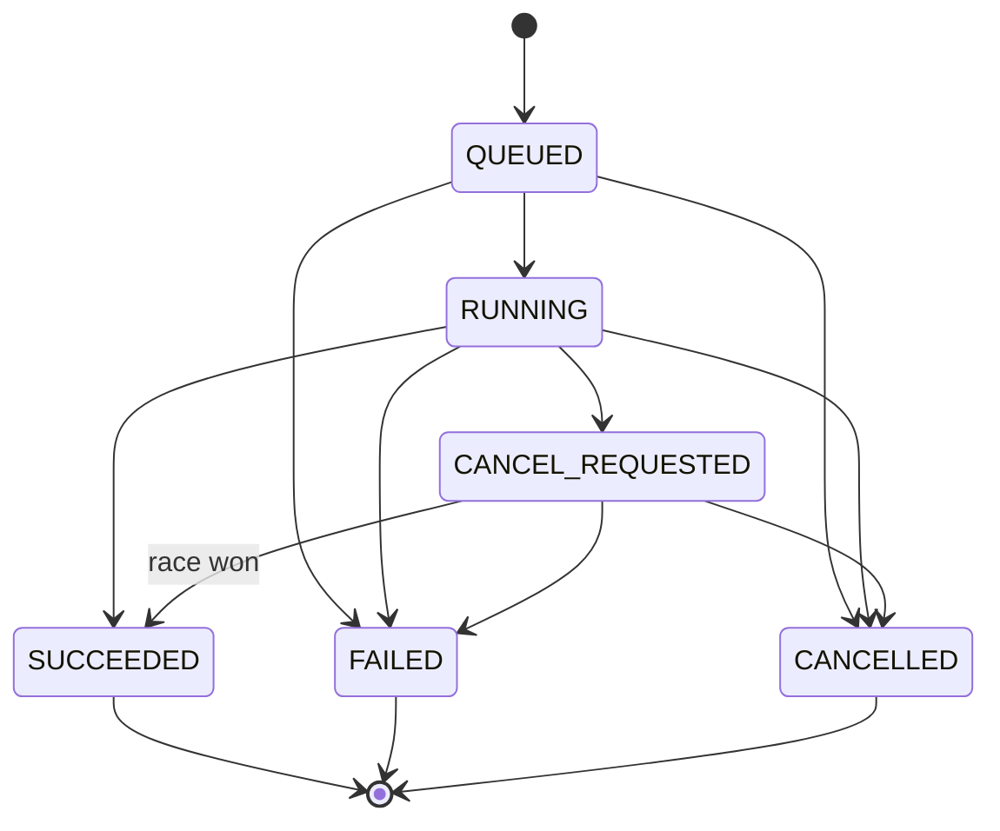

# ADR: Canonical Lifecycle and Result Contract

- Status: Accepted | Date: 2026-11-10
- Decision Makers: Dieter Olson (Owner), Fable, Antigravity Agent
- Related Issues/PRs: #6003, #6005, #6006, UpstreamDrift#14934, UpstreamDrift#14938

## Context

Across product repositories (`Tools`, `UpstreamDrift`, `Gasification_Model`), execution jobs and solvers used disparate state vocabularies (`COMPLETED`, `DONE`, `FINISHED`, `ERROR`, `ABORTED`). Status booleans often diverged from enums or masked solver failures. Furthermore, cancel races caused inconsistent outcomes when tasks finished just as cancellation was signaled.

## Part A: Lifecycle Convention

Canonical vocabulary: `QUEUED`, `RUNNING`, `CANCEL_REQUESTED`, `SUCCEEDED`, `FAILED`, `CANCELLED`.

### State Transitions

Rules: (1) Terminal states immutable; (2) `QUEUED` cannot transition to `SUCCEEDED`; (3) `CANCEL_REQUESTED -> SUCCEEDED` valid when work completes before cancel is observed.

### Lifecycle Snapshot

Frozen snapshot fields: `status`, `schema_version` (>= 1), optional `outcome`, and `failure` (required if `FAILED`, forbidden if `SUCCEEDED`). Read-only properties (never stored): `done`, `ok`, `cancelled`, `success`.

## Part B: Result Convention

1. **No Status Default**: Snapshots require explicit status initialization.
2. **Derived Booleans**: `success`, `ok`, `converged` must be derived read-only properties of status.
3. **Solver Convergence and Feasibility**: Numerical solvers require both convergence and feasibility checks.
4. **Finite Outputs**: Non-finite numbers (`NaN`, `Inf`) map to `NUMERICAL_FAILURE`, never silent `0.0`.
5. **Standard Basis**: Quantities dependent on reference states carry `standard_basis`.

## Reversibility Rule

- Lifecycle kernel is an opt-in helper at `src/shared/python/lifecycle.py`.
- No forced inheritance across domains; no submodule cross-repo coupling until tagged releases.
